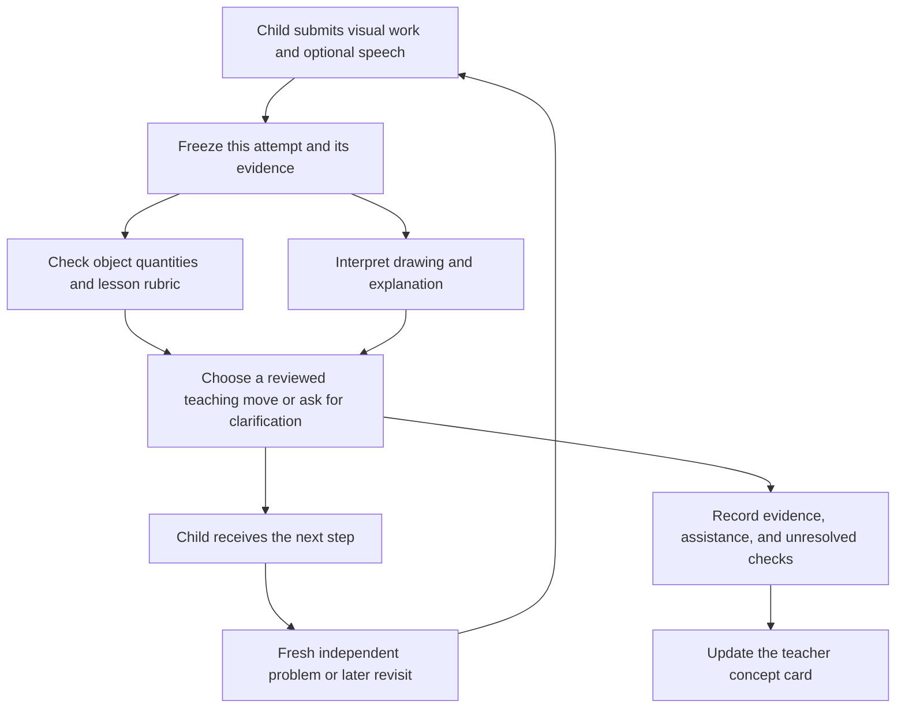

# ExplainBack Classroom — working concept

* **Author:** Proposed: Yuanshi, pending confirmation; Git author name and
  GIT_AUTHOR_NAME are unset.
* **Date:** 2026-11-11
* **Stage:** Consolidated concept review completed. The two major findings are
  revised below following the user's decisions; no implementation exists yet.
  See the [review report](consolidated_review_report.md) and
  [resolution record](review_resolution.md).

## Overview

Children work through short visual math challenges. They move objects, draw,
or explain their thinking; the app uses that work to choose a teaching response,
checks the concept on a different problem, and revisits it later. Teachers see
which concepts need attention, the evidence behind that finding, and a suggested
next teaching step as responses arrive.

The user confirmed the child audience, math as the first subject, engaging
activities, help with underlying misunderstandings, verification and repetition,
and real-time feedback for teachers. The age/grade, first concept, classroom
setting, and final product name remain open. To make the brainstorm concrete,
this draft proposes ages 7–9, one equal-groups lesson, and a small synthetic class.
These are assumptions for review, not user-confirmed requirements.

### Anchored hypothesis for review

A child learns one math concept through a visual mission, shows their thinking
with objects, drawing, and optional speech, receives a targeted teaching response,
then tries a new problem independently. A teacher view groups the observed
difficulties and suggests a specific next teaching step, with evidence and unknowns
visible. The proposed hackathon scope assumes ages 7–9, equal groups, original
materials, consenting adult demonstrators, and synthetic class data.

## Analysis

### The central risk

Participation, hints used, and a correct answer provide different information.
A child may guess, copy, misunderstand the question, or follow an example without
being able to apply the concept independently. The product should gather evidence
across tasks and show the limits of what has been checked. It cannot guarantee
understanding or diagnose a learning difficulty from a single response.

### Capture interest through the mathematics

Use a short mission with a visible purpose: share food between characters, build
a bridge of a given length, or complete a pattern. Let the child act on the
mathematical objects and see the consequence. Offer modest choices of theme or
representation while keeping the learning objective fixed.

Keep instructions short and allow showing, drawing, pointing, and speech. Celebrate
explaining a strategy, correcting an error, and completing a new challenge
independently. Treat these engagement choices as hypotheses to test with the
intended age group; attractive animation does not itself verify learning.

### Proposed learning loop

1. **Try:** Present a small challenge before giving away its solution.
2. **Show the thinking:** Ask the child to arrange objects, draw, or explain one
   relevant step. Speech is optional; expressive fluency is not the math score.
3. **Check the difficulty:** Compare the work with a small reviewed rubric. Ask a
   distinguishing follow-up when several explanations could fit the answer.
   Unclear recognition stays unresolved.
4. **Teach:** Give a small cue, model the relationship, or change representation.
   Connect the objects and diagram explicitly to the mathematical expression.
5. **Try independently:** Change the numbers, layout, or story and remove help.
   Keep the supported attempt separate from the independent check.
6. **Return later:** Revisit the concept after intervening work and, in a later
   product, another session. Vary the examples rather than repeat a memorized item.
7. **Invite teacher help:** If repeated attempts reveal no progress, change the
   explanation or ask for teacher support. Avoid trapping a child in endless retries.

This sequence is a product proposal informed by teaching guidance. IES recommends
systematic instruction, mathematical language, and concrete or diagrammatic
representations for elementary math intervention.
[IES elementary mathematics guide](https://ies.ed.gov/ncee/wwc/PracticeGuide/26/i).
IES also recommends retrieval, explanatory questions, and spaced revisiting, with
different evidence ratings for different recommendations. That guidance does not
establish an exact retry count, spacing schedule, or mastery threshold for this app.
[IES learning and study guide](https://ies.ed.gov/ncee/wwc/PracticeGuide/1).

### Illustrative first lesson: equal groups

This example assumes an early-elementary learner ready for equal groups; the user
has not selected that grade or topic.

“Feed three creatures four berries each.” A response of seven is a clue, not a
diagnosis. Ask the child to show where each berry goes. If their arrangement and
explanation support it, identify a possible confusion between adding the two
numbers and building three equal groups of four.

Model the groups and connect them to 4 + 4 + 4. Then use a new context, such as two
baskets with five apples in each, and ask the child to build and count independently.
Later, compare equal and unequal groups to check what the grouping means.

Possible checked skills: constructs the requested groups, keeps each group equal,
connects the arrangement to a quantity or expression, and applies the relationship
in an unfamiliar example. A counting slip and a grouping misunderstanding need
different responses.

### Give the teacher a next action

The teacher view should answer: what needs emphasis, what evidence supports it,
and which children need help or another check. A compact concept card could show:

| Field | Example content; all classroom data would be synthetic in the demo |
| --- | --- |
| Concept | Equal groups |
| Finding | Several assessed learners may be adding the two prompt numbers |
| Evidence | Their object arrangements and explanations support the same hypothesis |
| Suggested action | Model three complete groups and connect each group to repeated addition |
| Other learners | Separate those ready for a fresh challenge from those needing a follow-up |
| Coverage | Show assessed learners, missing responses, recognition failures, and stale evidence |

Counts must come from actual lesson events, with a visible denominator and last
update. An unsubmitted answer must not become a failure or a success. Teachers
can inspect supporting work, correct the interpretation, and choose the response.
Start with one concept and one useful card; avoid a large dashboard of weak scores.

### Clear the current finding when the child improves

The user decided that a finding can clear after the child improves. For this
draft, demonstrate that improvement by applying the targeted idea on a fresh
problem without a hint, with supporting work that meets the lesson's reviewed
criteria. The child can show this through object actions or an explanation; fluent
speech is not required. A correction completed with help remains supported practice
and leads to that independent check.

The teacher card describes current needs. Keep earlier evidence in the lesson
history and distinguish it from a finding that still needs attention.

| Latest evidence or action | Current teacher finding | History and next step |
| --- | --- | --- |
| Evidence supports a difficulty with the concept | Active: needs practice | Keep the work supporting the finding and select appropriate help |
| Child succeeds while receiving help | Still active: independent check pending | Record the help and give a fresh problem |
| Child applies the targeted idea independently on a fresh problem | Clear this finding and remove the child from its active count | Record the improvement; later review remains due |
| New evidence is unclear or conflicting | Add a clarification need; do not create a new confirmed misconception or clear an existing finding | Retain earlier confirmed evidence and ask a follow-up |
| Teacher corrects an unsupported finding | Retract that interpretation and update its count | Retain the correction and original observation; recheck if understanding is still unknown |
| Later work again supports the same difficulty | Reopen once for this child and concept | Attach the new evidence; do not count repeated attempts as additional children |

For example, if three of six assessed learners currently need equal-groups
practice, and one then meets the independent-check criteria, the active count
becomes two of six. The lesson history still shows that child's earlier difficulty
and subsequent improvement. A teacher correction also removes an unsupported label
from the active count and from summaries of confirmed historical difficulties,
while preserving the original entry as corrected. Clarification, missing work,
and later-review-due counts are shown separately from confirmed difficulties.
An unclear follow-up does not erase an earlier supported finding; it remains active
until improvement is demonstrated or its supporting interpretation is retracted.

Clearing a finding records improvement demonstrated in that check. It does not
establish permanent mastery or cancel a later review. Missing or delayed work
alone cannot reopen a misconception finding.

EEF guidance supports using formative evidence to identify gaps, target feedback,
and give pupils an opportunity to use it. This is support for the teaching approach,
not proof that an automated dashboard improves learning. Classroom alerts also
need prioritization so the teacher can teach while feedback arrives.
[EEF feedback guidance](https://educationendowmentfoundation.org.uk/education-evidence/guidance-reports/feedback).

### Describe progress honestly

Use evidence descriptions such as “needs a clearer check,” “completed with help,”
“applied independently in a new example,” and “later review pending.” Keep attempts,
assistance, recognition uncertainty, and later checks attached to the concept.
Do not turn a streak, a fluent explanation, or one successful demonstration into
a permanent mastery label.

The prototype should measure recognition/assessment errors on reviewed examples,
appropriate teaching responses, independent application, and teacher comprehension
of the card. Longer-term retention and classroom benefit need later evaluation.

### Three possible product shapes

| Approach | What the child does | What it gives us | Strongest objection |
| --- | --- | --- | --- |
| Guided visual mission | Moves objects, draws, and explains in a small authored world | Observable work, checked quantities, and a controlled teaching sequence | More lesson-authoring effort; a child might solve the interaction without learning the underlying rule |
| Worksheet conversation | Shows paper to a camera and discusses any problem | Familiar classroom materials and fewer constraints on input | Handwriting interpretation and open-ended math make reliable diagnosis harder to demonstrate |
| Teacher-led class check | Responds to a short question while a teacher leads instruction | A narrow first product with immediate classroom relevance | Leaves less room for the individual teaching-and-repetition loop requested here |

Propose the guided visual mission plus one teacher card as the first slice. Keep
paper upload as a later input mode. This makes the first assessment depend on
actions whose quantities can be checked, while retaining drawing and voice as
useful evidence. The cost is a deliberately narrow lesson rather than a general tutor.

### The first child-facing screen

Show three creatures, movable berries, and one short prompt. Give the child a
large work area, an optional speak button, a way to draw, and a clear submit action.
Use a calm fictional guide; place mathematical objects ahead of decoration.

After submission, highlight only the relevant objects and ask one question at a
time. Show a small visible path through the mission: try, explain, practice,
challenge. A child can request help or pause. Avoid time-pressure mechanics in
this initial concept-checking activity; fluency practice is a separate objective.

The effect of a mission, character, or reward on engagement remains a hypothesis.
Observe whether children understand the instructions, can use the controls, keep
working after an error, and explain what changed. Time spent on screen alone is
not evidence of either attention or learning.

### Distinguish mistakes before selecting help

All cases below are invented examples for designing the lesson and its checks.

| Work observed | What remains uncertain | Useful next action |
| --- | --- | --- |
| Child enters 7 without showing groups | Adding 3 and 4, a counting slip, misunderstanding the prompt, or input error | Ask what the 3 and 4 represent and invite them to show it |
| Child builds piles of 3 and 4 and says they added them | Evidence supports a possible grouping misunderstanding | Model three groups, relate each group to four objects, then invite another construction |
| Child builds three groups of four but counts 11 | Grouping may be understood; counting needs another check | Support counting while retaining the child's correct grouping |
| Child constructs the groups but gives little spoken explanation | Speech or language may be limiting the explanation | Use another arrangement, pointing, or drawing to gather mathematical evidence |
| Child builds three groups of four but says they added three and four | The arrangement and spoken explanation conflict; the misconception is unconfirmed | Ask the child to show what their numbers mean and explain the counting step before selecting targeted help |
| Child repeats 12 on a different problem with a different total | Prior success has not transferred to the new case | Ask them to rebuild the new quantities and revisit the relevant relationship |
| Speech or drawing cannot be interpreted | No reliable mathematical conclusion is available | Clarify the captured input or offer direct object manipulation |

Counting all objects is a valid strategy for an early equal-groups lesson. Do not
require multiplication notation or fast recall unless those are separately stated
objectives appropriate to the chosen grade.

### Ask for the child's reasoning when evidence disagrees

The user decided to ask the child to explain more so the model can better evaluate
their reasoning and help them reason through the task. Ask about observable steps
and meanings; the model does not have direct access to the child's thoughts.

For the conflicting example above, start with one neutral question: “Show me what
the three means in your picture.” If needed, follow with: “How did you use the
groups to find the total?” Let the child point, move objects, or explain in their
own words. Do not supply the intended answer inside the question or require a
longer spoken response as proof of understanding.

Compare the new response with the original work and reviewed lesson criteria:

* If the child connects three groups to four objects in each and shows how they
  counted, treat the earlier phrase as clarified; do not retain an unsupported
  misconception label created from that disputed phrase. An earlier, separately
  supported finding still requires its independent improvement check.
* If the response supports adding the two prompt numbers instead of constructing
  the requested groups, record that specific difficulty and choose the reviewed
  grouping explanation.
* If the conflict remains or recognition is uncertain, keep “needs clarification”
  visible and offer another representation or teacher help. Do not force a label
  merely because the model produced a plausible explanation.

Record the follow-up and any teaching or hints used. Once clarification becomes
teaching, verify improvement on a fresh unaided problem before clearing an active
finding. A resolved speech ambiguity can retract a false interpretation immediately;
that is a correction to evidence, not a new claim of independent learning.

### Repetition that changes the evidence

Separate three kinds of follow-up:

* **Supported practice:** the same relationship with a worked example or hint.
* **Independent application:** a new problem, with no solution cue or hint. Change
  the numbers, arrangement, or story while preserving the concept being checked.
* **Later retrieval:** return after other work or a later session to see what is
  recalled. Mark the actual interval; a sped-up stage demo is not a retention study.

Do not declare mastery after a fixed number of wins. Show which rubric elements
were demonstrated, how much support was used, and which checks remain open. If a
child remains stuck, try a different representation or surface teacher help rather
than continually regenerate the same kind of question.

### How the parts could work together

This is a proposed organization of responsibilities, not a selected technology stack.

Keep lesson content separate from the model: an authored problem, expected
quantities, rubric, possible misconceptions, teaching moves, and transfer problems.
Direct object actions provide reliable counts. The model interprets drawings and
speech and proposes a bounded next move; it should not invent the math objective,
change the problem, or manufacture a teacher statistic.

Send a work snapshot with a short explanation when the learner submits. Avoid
continuous camera streaming for this first design. The demo should genuinely
process visual work plus spoken explanation; offer image/text and direct controls
when speech is unavailable. Show recognized content in a form the learner can correct.

Store each submitted attempt with its lesson, problem and revision identity, the
evidence used, assistance provided, rubric observations, and any uncertainty. If
the child changes the work, a late response to the old revision must not replace
the current teaching step. A corrected or retried event must not create a second
child in the teacher count. Keep different children's contexts separate.

The teacher page can receive server-pushed lesson updates as submissions are
processed. Derive its card from those same attempt records, with the number of
distinct learners assessed and the time of the latest evidence. Keep shared
classroom findings and individual follow-up visible without an alert for every click.

If model interpretation is unavailable, show an authored help route and mark the
interpretation as unavailable. Do not generate a diagnosis from a timeout or
present a fixture as a live model result. Select a provider and a project-designated
credential only when implementation needs actual live access.

### Existing work and the minimum new work

Blitz Learning offers authored equal-groups activities, deterministic checking,
diagrams, and distinctions between supported practice and independent wins.
Pondside offers a bounded scene and optional conversational input. Those are
reusable starting points, subject to event reuse rules; neither is already this
child-facing assessment-and-teacher product.

The new work is the explicit reasoning rubric, the attempt/evidence record,
bounded selection of teaching moves, varied independent checks, and a live teacher
card. Keep the child interaction simple before adding broader free-form input.
The public adult-only demos retain their existing scope.

A read-only source inventory found these specific starting points. It did not run
the application or verify current live-model access.

| Existing source | Reusable behavior and limit |
| --- | --- |
| [quests.mjs](/Users/yuansshi/Documents/Codex/2026-08-30/https-wx-m-tv-sohu-com/blitz-learning/quests.mjs) | Six authored equal-group questions with quantities, hints, local answer checks, and assistance flags; select content appropriate to the eventual grade |
| [blitz-state.js](/Users/yuansshi/Documents/Codex/2026-08-30/https-wx-m-tv-sohu-com/blitz-learning/public/blitz-state.js) | Accessible static group diagrams; draggable objects and drawing assessment would be new |
| [lesson.mjs](/Users/yuansshi/Documents/Codex/2026-08-30/https-wx-m-tv-sohu-com/blitz-learning/lesson.mjs) | Older pond-specific objectives and misconception criteria; a pattern to adapt, not an existing equal-groups reasoning assessor |
| [server.mjs](/Users/yuansshi/Documents/Codex/2026-08-30/https-wx-m-tv-sohu-com/blitz-learning/server.mjs) | Existing local session boundary; teacher/classroom routes and the proposed event flow are new, and the current application remains adult-only |

### Build order for a demonstrable prototype

1. Author one lesson with original art, a small rubric, representative errors, hints,
   and fresh check problems. Review the mathematics independently.
2. Test the proposed image/voice interpretation path early with a few reviewed
   synthetic cases, including unclear input, using designated project access.
   Measure actual delay and inspect the returned evidence. Keep live capability
   unverified if access is missing; labeled fixtures can support interface work.
3. Make one child's visual task work from prompt through checked submission,
   teaching response, and independent check, including an unclear-input route.
4. Connect one teacher card to real attempt events. Replay labeled synthetic peers
   through the same event path to demonstrate a class pattern.
5. Rehearse the two-minute story: initial difficulty, useful teaching response,
   independent check, teacher action. Reset must clear the previous demonstration.

The largest cuts, if needed, are paper-camera capture, broad free-form conversation,
accounts, curriculum generation, and elaborate characters. Preserve the child
learning loop, genuine multimodal input, and teacher evidence in the demo.

### What would change our minds

* If children can complete the manipulations without understanding the concept,
  strengthen the unfamiliar application check or change the activity.
* If input recognition creates false misconception labels, prefer structured work
  and clarification until the model path is reliable enough to be useful.
* If teachers cannot turn a card into a teaching action, reduce its claims and
  refine the evidence and next-step wording with a teacher.
* If a short regular teacher check serves the same need with less effort, narrow
  the app to the individual support it can actually provide. The AI component
  needs to earn its place by improving the response to a learner's work.

## Goals vs. Non-Goals

### Confirmed direction

* Help children learn math through engaging activities.
* Use their work to discover where understanding breaks down.
* Respond with teaching, verification, and meaningful repetition.
* Give teachers timely feedback about concepts worth stressing.
* Clear a child's active finding after demonstrated improvement, preserving the
  earlier evidence and later-review status.
* Ask the child to explain or show more of their reasoning when the available
  evidence disagrees, then use that evidence to select appropriate teaching.

### Proposed hackathon slice, pending age and concept selection

* One concept, one short child-facing activity, and one compact teacher view.
* Visual work/handwriting plus spoken or written explanation, with an accessible
  non-speech route through the task.
* A small reviewed set of problems, responses, and teaching moves.
* One visible struggle → teaching response → new independent check → teacher update.
* Synthetic class sessions and original worksheets with consenting adult demonstrators.

### Outside the first slice

* A complete curriculum, learning-disability diagnosis, automatic grading of all math,
  or a claim to guarantee mastery.
* A large analytics platform, school integrations, glasses, or new avatar production.
* A production child-facing service. Existing Blitz/Pondside prototypes are adult-only;
  their audience/provider permissions do not automatically transfer to this concept.
* Claims of long-term retention from a short demo. A compressed demo can show the
  later-review mechanism if clearly labeled; it cannot prove delayed retention.

## Alternatives Weighed

* **Unrestricted AI conversation:** flexible, but difficult to verify and may supply
  answers before the intended thinking. Prefer bounded reviewed tasks initially.
* **Repeated answer drills:** simpler, but repeating the same item can hide reliance
  on memorized patterns. Propose changed contexts and independent checks.
* **Entertainment-led math game:** could attract participation; the learning value
  must remain visible in the activity and subsequent checks.
* **Teacher-only analytics:** gives teachers information but leaves the individual
  child without the proposed teaching response. Keep both views narrow.
* **Earlier LabLens/video/glasses ideas:** remain historical candidates in
  [the initial research](hackathon_ideas.md). The user has now directed the concept
  toward children learning math and teacher feedback.

These alternatives remain proposed tradeoffs. The consolidated review and the
user's two follow-up decisions are recorded separately; they do not approve the
entire detailed design.

## Key Decisions & Staging for Next Steps

The user has established the audience category, subject, learning loop, and teacher
feedback direction. The proposed working scope is ages 7–9, equal groups, a guided
visual mission with optional speech/drawing, and one teacher concept card. Age,
topic, and author Yuanshi are assumptions awaiting confirmation rather than reasons
to delay making the proposal concrete.

The consolidated concept review is complete. The user resolved its two major
questions by allowing findings to clear after improvement and requesting further
child explanation when evidence conflicts. The sections above translate these
decisions into a teacher-card policy and clarification examples; see the
[resolution record](review_resolution.md) for scope and verification status.
Minor scope and wording recommendations from the original review remain separate.
No stack, provider, deployment, or implementation choice is established here.
Event constraints and prior asset references remain in the linked initial research.
