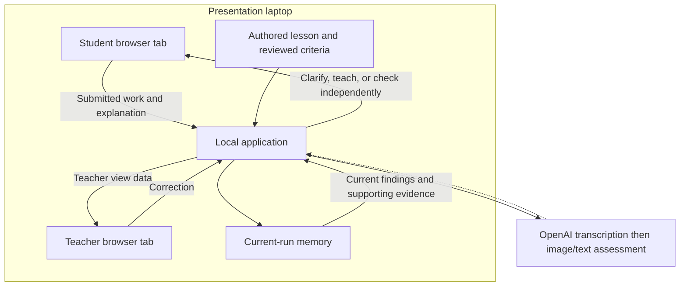

# ExplainBack Classroom

* **Author:** Yuanshi — carried from the concept brief.
* **Status:** Resolution revision — author-approved design updated to address the
  consolidated review; fresh implementation-readiness re-audit pending.
* **Date:** 2026-11-11
* **Updated:** 2026-11-13
* **Lesson choice:** Two-digit addition/subtraction with regrouping, selected by
  the author on 2026-11-12.
* **Audience:** Grades 1–6 product direction; Grade 2 is the approved design target
  for this first lesson. Learning effectiveness remains untested.
* **Audio lifetime:** Release after transcription; retain transcript evidence for
  the current run, without teacher audio replay.
* **Teacher updates:** Refresh the current snapshot about once per second, with
  visible freshness and failure states.
* **Interpretation route:** OpenAI transcription, transcript review, then drawing
  and text assessment; selected by the author after the audio probe.
* **Image lifetime:** Keep original drawings in process memory until reset or
  restart, subject to explicit submission limits; selected by the author.
* **Predecessor:** [Revised concept brief](concepts_brief.md).
* **Review decisions:** [Resolution record](review_resolution.md).

The author approved all design sections on 2026-11-13. The original finalized
snapshot and consolidated findings are preserved in [design_review](design_review/README.md).
This revision resolves the findings through the normative contracts linked in
Detailed Implementation; the [resolution record](design_resolution/goldfish_review_report.md)
tracks each edit. Architecture decisions and alternatives remain recorded in the
[technical](technical_plan_notes.md) and [implementation](implementation_plan_notes.md)
planning notes. This workflow creates design documents and temporary experiments;
no application exists yet.

## Overview

ExplainBack Classroom helps children work through a math concept using short visual
activities, explanations, targeted help, and independent practice. It uses the
child's work to investigate a difficulty, chooses a teaching response, and checks
the concept again in a different problem. Later revisiting remains separate from
immediate success.

Teachers receive a compact view of concepts that currently need attention, the
work supporting each finding, and a suggested teaching action. When a child shows
improvement, the active finding clears while earlier evidence remains available.
If the child's work and explanation disagree, the tutor asks the child to explain
or show more before assigning the disputed misconception.

The proposed first prototype covers one lesson and one teacher view. The author
selected two-digit addition/subtraction with regrouping as the first lesson,
superseding the brainstorm's equal-groups proposal. The broader product audience
is elementary Grades 1–6; the draft targets this first lesson at Grade 2, with
prerequisite checks rather than a grade-only entry rule. The demonstration still
covers one lesson. See the [audience rationale and readiness prompts](implementation_plan_notes.md#audience--grades-16-direction-proposed-grade-2-first-lesson).
This design defines observable evidence of performance; it does not claim that a
short demonstration establishes lasting learning.

## The Problem

A numerical answer gives incomplete information about a child's reasoning. A wrong
answer may come from counting, grouping, misunderstanding the instruction, or
misinterpreted input. A correct answer may follow a hint or copied example. The
teaching response needs to reflect the evidence available in that attempt.

Children need activities that invite them to act on mathematical ideas and a way
to show their thinking through objects, pointing, drawing, speech, or an appropriate
alternative. When they struggle, the next step should help them understand the
relationship being taught and give them another opportunity to apply it.

Teachers need to know what is worth emphasizing now. A finding based only on an
earlier mistake can become stale after a child improves. A finding based on unclear
or conflicting evidence can suggest the wrong teaching action. The teacher view
must distinguish current supported needs, clarification needs, historical
difficulties, and later review.

Existing Blitz Learning and Pondside components provide authored mathematics,
diagrams, and assistance-related behavior. The new reasoning checks, child
interaction, and teacher feedback flow are specified below and remain to be built. Their
existing adult-only applications retain their current boundaries.

## Goals

The criteria below describe intended prototype behavior. Detailed Implementation
defines the corresponding rules and verification gates.

| ID | Goal | Observable criterion |
| --- | --- | --- |
| G1 | Invite active mathematical thinking | A learner can understand a short task, act on its mathematical objects, and show how they reached a result. A suitable non-speech route is available. Engagement remains a hypothesis to evaluate with the intended audience. |
| G2 | Investigate the specific difficulty | Reviewed regrouping examples distinguish a value-preservation error, a computation error, and insufficient evidence when the submitted reasoning supports that distinction. A number or memorized rule alone does not establish conceptual understanding or a misconception. |
| G3 | Clarify disagreement before choosing targeted help | When visual work and explanation conflict, the tutor asks a neutral follow-up and accepts spoken or visible reasoning. Unresolved disagreement remains a clarification need. |
| G4 | Teach and check independent application | The learner can receive a targeted cue or explanation, then attempt a fresh problem without that assistance. The record distinguishes supported practice, independent performance, and later review. |
| G5 | Keep teacher findings current | A supported finding clears from the active count after demonstrated independent improvement. Earlier work remains available. Unclear or missing new work cannot erase a supported finding. A teacher can retract an unsupported interpretation with its correction history preserved. |
| G6 | Help teachers choose a teaching response | The teacher can identify the concept needing attention, inspect supporting work, understand the count and coverage, and choose a suggested teaching action. Repeated attempts do not count as additional children. |
| G7 | Demonstrate a complete multimodal learning loop | A stage demonstration processes submitted visual work and a spoken explanation, shows the interpreted evidence, and uses it to choose help or request clarification. The teacher view updates from those same learner events. Fixtures are identified when used. |

### Meaning of improvement in this draft

The user approved clearing a finding after improvement. Following the resolved
concept brief, this draft interprets improvement as applying the targeted idea on
a fresh unaided problem, with work that meets the lesson's reviewed criteria.
Actions can provide that evidence; fluent speech is not required.

An answer corrected with help leads to an independent check. A finding that clears
keeps its history and later-review requirement. A later supported difficulty can
reopen it. Resolving a misheard explanation or retracting a mistaken interpretation
corrects the evidence; it does not claim that the child learned a previously
missing concept.

### Meaning of clarification in this draft

The user approved asking the child to explain more when the available evidence
disagrees. Ask short, neutral questions about the child's steps and the meanings
of the objects or numbers. Compare the response with the submitted work and lesson
criteria, then choose a teaching action or retain the uncertainty.

If clarification introduces teaching or hints, use a fresh unaided problem to
verify improvement before clearing an established finding. A longer or more
persuasive explanation alone does not establish understanding.

## Non-Goals

* A complete math curriculum or unrestricted assessment of arbitrary homework.
* Learning-disability diagnosis, inferred attention scores, or a guarantee of
  conceptual mastery from a fixed streak or short demo.
* A large teacher analytics platform, school-system integrations, or general
  classroom administration.
* Glasses integration, continuous classroom video, or new avatar production in
  the first prototype.
* Production deployment for children or reuse of the existing adult applications'
  provider permissions for child access. The proposed hackathon demonstration
  uses original materials, synthetic class data, and consenting adult demonstrators.
* Declaring learning gains or long-term retention from synthetic examples or a
  compressed demonstration of a later-review mechanism.
* Implementing application code during this drafting workflow.

## Open Questions

The author-selected architecture and media lifetimes are now recorded in Detailed
Implementation. The remaining items below concern validation; they
are not unchosen framework, storage, provider, or transport alternatives.

| Decision | Current position | Why it matters |
| --- | --- | --- |
| Lesson validation | Grades 1–6 is the product audience; the author approved the Grade 2 lesson target and criteria, while actual teaching visuals and learner behavior remain untested | Determines whether the designed explanations work in practice |
| Freehand interaction verification | Board dimensions, export, limits, recognition review, and written alternative are specified below; their actual browser behavior remains untested | Determines whether submitted evidence is usable |
| Lesson and demonstration details | Authored prompts and visual sequences are specified in the learning contract; their implemented rendering still needs review | Determines what the child sees and the teacher observes |
| Design readiness | The original consolidated review identified eight Major gaps; this resolution revision requires a fresh readiness re-audit | Review findings remain distinct from author approval and implementation evidence |
| Media lifecycle verification | Transient audio and current-run image rules are selected; actual cleanup, bounds, and reset behavior remain unimplemented | Determines whether retained evidence matches the chosen lifetime |
| Live interpretation and demo feasibility | Six regrouping audio cases completed with expected outcomes; real recordings, browser drawing input, and end-to-end delay remain untested | The live multimodal gate below determines whether the demo path is ready |
| Lesson review and evaluation | Grade 2 wording, criteria, and teaching actions are drafted; the worked visuals and full learning loop still need review and implementation checks | Audio classification is not evidence of teaching effectiveness |
| Product name | ExplainBack Classroom remains a working name | A label change does not change the bounded implementation contract |

The [original concept review](consolidated_review_report.md) and
[final design review](design_review/consolidated_review_report.md) are historical
records. Current finding dispositions are in the
[resolution report](design_resolution/goldfish_review_report.md). The completed
[audio experiment](regrouping_audio_probe.md) retains its limited meaning; browser
work, teaching effectiveness, and the full live path still require their checks.

## Critical User Journeys (CUJs)

### CUJ 1: a learner improves and the teacher finding clears

* **Given:** a synthetic learner and teacher view share a prepared lesson session.
* **When:** submitted work supports a difficulty, the learner receives teaching,
  and then applies the concept on a fresh unaided problem.
* **Then:** the active finding clears and its teacher count decreases once. Earlier
  work and assistance remain available during the current application run, and
  later review stays due. A hinted correction alone cannot clear the finding.

### CUJ 2: visual work and explanation disagree

* **Given:** submitted work and an explanation support different interpretations.
* **When:** the application evaluates that attempt against the lesson criteria.
* **Then:** the tutor asks a neutral follow-up and accepts speech or visible actions.
  Unresolved disagreement remains a clarification need. It cannot create a new
  confirmed misconception or clear an earlier supported finding by itself.

### CUJ 3: a teacher corrects an unsupported interpretation

* **Given:** a teacher can inspect the evidence supporting a finding.
* **When:** the teacher retracts an unsupported interpretation.
* **Then:** the finding and its relevant count update, while the observation and
  correction remain available for the current run. The correction does not count
  as a child demonstrating improvement.

### CUJ 4: a tab refreshes, an answer arrives late, or the app restarts

* **Given:** the two tabs are connected to a running local demonstration.
* **When:** a tab refreshes, a superseded interpretation arrives, or the operator
  restarts the application.
* **Then:** a refresh reconnects to the running demonstration without duplicating a
  learner. An obsolete result cannot overwrite current work or a teacher correction.
  An application restart ends the previous run and starts with no retained progress.

## Technical Plan (Architecture)

### Selected execution and state lifetime

Run the application on the presentation laptop. The student and teacher browser
tabs use the same local application and the same in-memory lesson records. There
is no progress database or automatic restoration after an application restart in
this prototype.

The lifetime of the running local application bounds its attempts, assistance,
findings, teacher corrections, and later-review status. Later revisiting can occur
after intervening work while that application remains running. Review in a new
application run is outside the selected prototype scope.

### Responsibilities and data flow

The following are logical responsibilities within the local application. They do
not introduce separate deployed services or commit to particular source modules.

| Responsibility | Required behavior |
| --- | --- |
| Student view | Present the authored activity, capture the chosen work/explanation inputs, show the submitted evidence, and display the next teaching step |
| Lesson rules | Provide reviewed quantities, reasoning criteria, possible difficulties, teaching moves, and fresh independent problems |
| Interpretation boundary | Associate observed image/explanation evidence with the submitted attempt; return usable observations or a clarification need |
| Learning controller | Compare observations with the reviewed criteria, resolve disagreements through follow-up, record assistance, and choose teaching or an independent check |
| Current-run memory | Retain submitted work references, observations, assistance, corrections, current findings, and later-review status for the running demonstration |
| Teacher view | Derive current counts and examples from those records, show unknowns and coverage, and submit corrections |

The model can interpret submitted work and explanation, but it cannot redefine
the lesson quantities, award independent success after help, or manufacture a
teacher count. The learning controller uses reviewed criteria and recorded evidence
to update the current finding. When evidence conflicts, it requests clarification
before assigning the disputed misconception.

### Current-run memory and restart behavior

| Event | Required result |
| --- | --- |
| Student or teacher tab refreshes | Reconnect to the current demonstration and its selected learner; retain progress while the local application is still running |
| The same attempt is submitted again | Recognize the repeated submission; do not add another learner or apply the same finding transition twice |
| The learner changes submitted work | Associate interpretation with the submitted version; a response for an older version cannot replace the current teaching step |
| The teacher corrects an interpretation | Retain the correction for this run; an older pending model result cannot undo it |
| Operator explicitly resets the demonstration | Clear that demonstration's records and invalidate its pending results before creating the fresh session |
| Local application stops, crashes, or restarts | Discard all current-run progress; old tabs must recognize that their previous run ended |

A fresh demonstration has a distinct session identity. Every accepted submission,
interpretation, and correction must belong to the current session and the relevant
submitted-work version. This requirement prevents late results from a reset or
previous application run appearing in a fresh demonstration. Teacher updates use
periodic snapshot requests; the [API contract](design_resolution/api_contract.md)
defines identifier formats, revision scopes, and concrete payloads.

There is no hidden progress restoration from browser storage or disk. The selected
memory lifetime concerns this application's progress records; it does not define
retention by an external model provider. The author selected release of recorded
audio after transcription, retaining transcripts and correction history for the
current run. The teacher view cannot replay audio. Failure, cancellation, and
reset also release the associated recording and invalidate late results. See the
[audio lifecycle](implementation_plan_notes.md#audio-lifetime--release-after-transcription-selected).
Original drawings remain in process memory for the current run. Capture bounds
and provider handling are specified in Detailed Implementation.

### Teacher findings and corrections

Compute the teacher card from the same current-run records used for student
feedback. Count distinct learners for the concept, not submissions. Show the
number assessed, active supported needs, clarification needs, missing work, and
the age of the displayed evidence. Clarification needs may coexist with an earlier
supported finding; these labels are not necessarily mutually exclusive groups.

An assisted success leaves an independent check pending. A fresh unaided success
meeting the reviewed criteria clears the active finding and updates its count,
while retaining the earlier work and later-review status for this run. Teacher
retraction corrects an unsupported interpretation with its history retained.
Unclear new work does not erase previously supported evidence. The
[chronological learning reducer](design_resolution/learning_contract.md) defines
correction effects, and the [snapshot contract](design_resolution/api_contract.md)
defines the assessed denominator.

### Interaction contracts

The local application needs operations to open or select a demonstration session,
retrieve its current student/teacher view, submit work, submit a clarification,
apply a teacher correction, and reset the demonstration. The next teaching step
and teacher card must refer to accepted evidence from the same session.

The author selected teacher refresh about once per second. The view requests a
whole current snapshot, allows only one request at a time, and shows the last
successful synchronization separately from the learner evidence time. Failed
refreshes leave the last data visibly stale rather than resetting counts. Run,
session, and revision checks prevent an old poll from undoing a correction or
repopulating a reset demonstration. See the
[polling contract](implementation_plan_notes.md#teacher-updates--periodic-refresh-selected).

These behavioral contracts are made concrete by the HTTP operations and data
shapes in Detailed Implementation. This workspace has no existing application
API to migrate.

### Existing code and proposed new work

Existing Blitz source contains authored equal-group questions and hints, static
group diagrams, assistance tracking, and older pond-specific assessment criteria.
Those are reuse candidates; they do not already implement the child interaction,
reasoning assessment, or teacher view proposed here. See the source inventory in
[the concept brief](concepts_brief.md).

The primary work area is freehand drawing or writing accompanied by an explanation.
The submitted image and explanation must identify the same attempt and work version.
The child can inspect what was recognized and clarify ambiguous marks before they
support a mathematical finding. An accessible non-speech response remains available.
Recognition of a drawing's contents is distinct from assessment of the reasoning;
pointer-stroke counts are not mathematical object counts.

The selected stack is Node.js with plain browser JavaScript/SVG. React, TypeScript,
and Vite are not part of the chosen frontend approach. The new application work
consists of the student and teacher views, the reviewed
lesson/rubric, interpretation-to-teaching flow, and shared current-run records.
No changes to the existing public adult demonstrations are implied. The detailed
implementation section below contains the complete file inventory for the selected
provider, capture/media, and interfaces; this drafting step creates no application
files.

### Interpretation availability and remaining verification

Unavailable or unclear interpretation must be visible. The application can offer
authored help and an accessible alternative, but it must not display that path as
a successful live assessment or create a misconception from a timeout.

Detailed Implementation specifies the freehand capture, media lifetimes, OpenAI
route, reuse boundaries, HTTP interfaces, student response handling, and periodic
teacher refresh. Local hosting does not establish offline model operation; the
live path requires internet access and the project-designated provider credential.

The early feasibility case must capture visual work and an explanation, show what
was interpreted, and use that evidence to choose a reviewed response or clarification.
The actual result and response delay should determine whether to proceed, simplify,
or report the live path as unready. OpenAI authentication and six synthetic
regrouping audio cases completed. The full visual-work prototype, actual teaching
visuals, real recordings, and response-time criteria remain untested.

Author approval and document readiness do not establish that the live path works;
the implementation gate below supplies that evidence.

## Alternatives Considered

This section carries forward the [brainstorm alternatives](concepts_brief.md)
and [execution/storage comparison](technical_plan_notes.md). Each disposition
records the author's selected scope and its design rationale.

### Deployment and history alternatives

#### Shared service on room Wi-Fi

* **Mechanism and benefit:** a student device and teacher device reach an
  application running on the laptop, demonstrating separate devices.
* **Tradeoffs and failure conditions:** network isolation, changing addresses,
  and trusted HTTPS for remote microphone access add setup dependencies. The
  separate-device demonstration fails if the devices cannot reach or trust the host.
* **Disposition:** not selected for the first prototype. The author chose one
  laptop with student and teacher tabs, so device sharing is outside the current
  demonstration requirement. This records the selected scope rather than a
  permanent rejection of classroom networking.

#### Private hosted web application

* **Mechanism and benefit:** student and teacher devices open an HTTPS URL and
  share a hosted application without reaching the presentation laptop directly.
* **Tradeoffs and failure conditions:** application hosting, access controls,
  shared-state lifecycle, and service availability add work. A deployment or
  connectivity failure can prevent the stage demonstration.
* **Disposition:** not selected for the first prototype because the author chose
  local laptop execution. This concerns application hosting; it does not decide
  whether the interpretation model runs locally or through an external provider.

#### SQLite progress persistence

* **Mechanism and benefit:** save attempts, corrections, and findings in a local
  database so the application can restore progress after restart.
* **Tradeoffs and failure conditions:** adds schema, write-error, recovery, and
  reset behavior. Its additional recovery benefit matters when progress must
  survive an application restart; file loss or unsuccessful writes still need handling.
* **Reason for rejection:** **Rejected by author for this prototype:** the chosen
  scope is current-demo-only memory, with progress cleared on application restart.
  Cross-restart recovery and persistent progress are therefore outside the current
  build. This does not select any raw-media or external-provider retention policy.

### Learning approaches considered in the brainstorm

These predecessor alternatives explain the fit of the selected learning loop
with the approved goals and Technical Plan.

| Alternative | Benefit | Tradeoff or condition where it falls short | Reason for non-selection as the complete approach |
| --- | --- | --- | --- |
| Unrestricted AI tutoring | Flexible questions and explanations across topics | Open-ended responses are harder to verify and may supply the answer before the intended thinking | The approved plan keeps lesson quantities, criteria, and teaching moves reviewed and bounded. Conversational explanations within those boundaries remain possible. |
| Repeated identical answer drills | Straightforward practice with checked answers | A learner can repeat a remembered answer without applying the underlying relationship in a new case | The approved goals require explanation or visible work, fresh independent checks, and later revisiting. Repetition remains part of the design; identical-item success alone is insufficient verification. |
| Entertainment and reward progression as the primary assessment | Gives the experience a mission and visible progress | Participation, score, or completion can occur without the intended mathematical understanding | Mathematical work and independent checks supply the evidence. Playful missions, characters, and appropriate rewards remain compatible with the design; their engagement effect still needs evaluation. |
| Teacher-only analytics | Concentrates the prototype on one teacher-facing workflow | Identifies a possible difficulty without providing the requested individual teaching and independent-check loop | The approved scope includes both the child's learning experience and timely teacher feedback, so the teacher card complements that loop. |

### Earlier project directions

LabLens, lecture/video learning, and Practice Lens were earlier candidates in the
[initial research](hackathon_ideas.md). The author directed this project toward
children learning math and teacher feedback. The approved first-prototype scope
uses a laptop application and excludes glasses integration. These candidates
remain separate ideas or possible sources of relevant teaching material; this
section does not declare them technical failures or reject video learning generally.

### Subsequent choices and review status

The provider alternative was Gemini combined image/audio interpretation. It can
avoid a separate transcript step but requires different credentials and fresh
access and interpretation checks. **Rejected by author for this prototype:** the
author chose the OpenAI transcription-review-image/text route already exercised
for audio. The image-lifetime alternative released drawings after interpretation
and retained descriptions only. **Rejected by author for this prototype:** the
author chose to let teachers reopen original drawings during the run, accepting
that explicit memory limits may stop new submissions. These are scope choices,
not claims that either alternative technically failed.

## Detailed Implementation Plan

This section is the implementation contract for the selected prototype. Its
parameters and lesson content were approved together by the author on 2026-11-13.
The original consolidated review and its frozen snapshot remain unchanged. The full
browser drawing-and-audio path must pass its live gate during implementation;
the completed [regrouping audio probe](regrouping_audio_probe.md) establishes only
the six documented synthetic audio outcomes.

The following linked contracts are **normative parts of this plan**, to be read
with the main document. They replace the earlier under-specified action, replay,
transport, fixture, PNG, and checkpoint descriptions; they do not add framework,
provider, storage, or deployment choices.

| Contract | Owns |
| --- | --- |
| [Learning](design_resolution/learning_contract.md) | Authored content/actions, total decision dispatch, assistance, scheduling, chronological correction replay |
| [API](design_resolution/api_contract.md) | Exact request/response/error schemas, IDs, revisions, adapter boundary, snapshots |
| [Fixtures](design_resolution/fixture_contract.md) | Server-owned matching, fault controls, fake microphone, A–F seed event recipes |
| [Media](design_resolution/media_contract.md) | Restricted PNG admission, byte/raster bounds, safe failures |
| [Verification](design_resolution/verification_contract.md) | Six-case synthetic probe, five implementation phases, actual browser/live gate and clocks |

### 1. Runtime, provider, and data lifetime

Use Node.js 24, its built-in HTTP server, `fetch`, `FormData`, environment-file
parser, and test runner. Use plain browser JavaScript modules, HTML, CSS, and an
SVG work surface. There is no frontend build step or runtime framework. Use
`@playwright/test` only as a development dependency and commit its resolved
version and lockfile when implementing.

The author selected the OpenAI route. Use `gpt-transcribe` for completed audio and
`gpt-5.6-terra` for image/text assessment, matching the tested audio configuration.
The latter's drawing assessment remains to be verified. Call the official
transcription and Responses endpoints directly from Node. Use strict structured
output, `reasoning.effort: low`, `store: false`, no background mode, and no Files
or Conversations API. Each assessment receives the frozen work, confirmed text,
authored problem, target criteria, and allowed action IDs; external context must
not redefine the problem or control application state.

Read `OPENAI_API_KEY` only from this project's `.env` for live operation; do not
fall back to an unrelated inherited credential. Keep the key on the server. The
proposed non-secret configuration is `OPENAI_TRANSCRIBE_MODEL=gpt-transcribe`,
`OPENAI_REASONING_MODEL=gpt-5.6-terra`, `ASSESSMENT_MODE=live`, and `PORT=3000`.
Fixture mode must be explicitly selected and must never call OpenAI or silently
replace a failed live request. Both views identify prepared-example processing
when fixture mode is active. Use the system certificate trust store with TLS
verification enabled, as in the successful probes.

Bind to `127.0.0.1`. Serve the two views and API from that same origin. Validate
the expected Host and Origin on mutations, accept no cross-origin API access,
bound request bodies, and serve evidence with `Cache-Control: no-store`. These
are local-demo boundaries, not an account or classroom authentication system.
Use only the six fixed synthetic roster identities, Learners A–F, for the demo.

| Resource | Proposed bound and behavior |
| --- | --- |
| Drawing | White 1024 × 768 board; at most 1 MiB (1,048,576 bytes) of PNG file bytes after base64 decoding, at most the board dimensions; restricted RGB/RGBA validation and metadata normalization per the media contract; decompressed filtered raster is separately bounded at 3,146,496 bytes |
| Editable strokes | At most 20,000 points per submitted work version; bounded numeric coordinates; never derive mathematical counts from strokes |
| Explanation/history | At most 4,000 characters per turn, 12,000 in current assembled text, 16 evidence versions and separately 16 explanation turns per attempt, and 64 KiB total retained text/correction history per attempt |
| Audio | Browser capture stops at 60 seconds; server enforces the 10 MiB byte limit. Negotiate browser-supported WebM/Opus or MP4; accept WAV for the synthetic probe; unsupported recording offers the non-speech route |
| API requests | At most 2 MiB for JSON and 10 MiB for binary audio; reject excess with `413` before provider submission |
| Current-run capacity | At most 128 immutable submitted work versions/attempts, 64 MiB of retained PNG bytes, and 2,048 accepted mutation/idempotency records; admit a whole mutation or reject it without partially changing state |
| Provider work | At most two in-flight provider calls across the demo; reject additional starts as temporarily busy rather than grow an unbounded queue |
| Timeouts | 45 seconds for each provider call; 5 seconds for snapshot requests; no automatic paid retries |
| Refresh | Request immediately, then about 1,000 ms after the preceding snapshot request settles; one active request and one owned timer per view |

These are the selected implementation limits for the bounded demo, not measured memory
capacity or latency claims. A capacity rejection leaves prior work available and
tells the operator that new work needs a reset or restart. Do not evict earlier
drawings silently. Store PNG byte buffers and structured records in process
memory; teacher snapshots contain evidence URLs, not base64 image bodies.
Each attempt owns one immutable work version; evidence revisions reference that
image rather than copy it. Idempotency records retain fingerprints and result IDs,
not duplicate media or complete snapshots. Reset and cleanup/cancellation remain
available at capacity. The browser's duration timer is not a server-side proof
of recording duration; the server enforces the independently bounded byte limit.

Stop microphone tracks when capture ends. Release browser upload buffers when
they are no longer needed and server audio in a `finally` cleanup after
transcription, failure, timeout, or cancellation. Keep no audio attachment or URL
in retained state. Transcript review and corrections remain available for the
current run, without teacher replay. Original drawings and their evidence versions
remain available until reset/restart. Browser storage, disk progress, and audio
or image logs are not part of the application. Cleanup must be repeatable and
scoped to its own attempt so an old request cannot dispose a newer recording.

Local release is distinct from provider handling. The current OpenAI data table
lists no abuse-monitoring or application-state retention for transcription;
Responses has separate default abuse-monitoring retention. `store: false` does
not assert project-wide Zero Data Retention, and this project has not verified
such an account setting. The demonstration uses synthetic material or adult
role-play as already scoped; actual child deployment is not established by this
design. See [provider data controls](https://developers.openai.com/api/docs/guides/your-data),
[transcription](https://developers.openai.com/api/docs/guides/speech-to-text),
and [image input](https://developers.openai.com/api/docs/guides/images-vision).

### 2. Authored lesson and decisions about evidence

Keep one Grade 2 lesson within the broader Grades 1–6 product direction. Use
two-digit positive operands, totals below 100, nonnegative differences, and one
exchange between tens and ones. Do not include exchanging through zero in this
first content set. Keep addition and subtraction exchange targets separate.

| Target | Supported-practice problem | Unused independent-check pool, in order | Later-review problem |
| --- | --- | --- | --- |
| Addition exchange | `27 + 18 = 45` | `36 + 27 = 63`; `47 + 25 = 72`; `58 + 17 = 75` | `48 + 26 = 74` |
| Subtraction exchange | `42 - 17 = 25` | `54 - 28 = 26`; `62 - 18 = 44`; `81 - 57 = 24` | `83 - 46 = 37` |

The application begins with addition practice. Reviewed warmups are available
when needed: show 34 as tens and ones, explain `23 + 14 = 37`, and explain
`46 - 12 = 34`. They are help, not a grade-based eligibility gate or a validated
placement test. A warmup or worked step marks the current assignment assisted.
Use short concrete language and accept drawings, writing, and everyday phrasing.

Answer correctness, valid strategy, exchange evidence, recognition uncertainty,
and assistance are separate fields. Compute the expected answer from the authored
operands and operation on the server. A correct procedure without the value of
the carried one explained is unverified exchange evidence, not a misconception.
A correct guess is also unverified. Accept compensation, counting, decomposition,
and other valid methods; if a method does not expose the exchange relationship,
ask for that evidence without calling the method wrong.

The two supported exchange-difficulty codes are `addition-omitted-ten` and
`subtraction-value-changed`. Require usable source-linked evidence, rather than a
wrong number alone. For addition, derive the combined tens and ones from the
current operands; the supported error explicitly drops the ten from a ones sum
of at least ten without adding it to the tens total. For subtraction, derive the
minuend's tens and ones; the supported error adds ten ones without reducing the
tens by one, increasing the represented starting value by ten. Fifteen ones and
42 becoming four tens/twelve ones are practice examples, not fixed quantities in
the rules. Apply these predicates to the fresh and review problems too. A conflicting image
and explanation, unclear speech, unreadable work, or a correct answer paired with
contradictory reasoning selects clarification before assigning that disputed code.

Model output proposes observations and an authored action ID only. Validate its
shape, allowed enums, bounded text, source references, and exact text quotations.
Where it reports tens/ones quantities, compute their values and compare them with
the authored quantities. Require conservation for a supported-exchange claim;
preserve a grounded inequality as evidence of the value-change error. A learner's
wrong numbers are not an unusable provider response merely because they are wrong.
Reject ungrounded/invented observations, invalid schemas, and unsupported action
IDs separately from mathematical errors in the learner's actual evidence.
The model cannot change counts, mark work independent, clear findings, or create
new teaching instructions. Do not display raw model prose as the child's next step.

The [learning contract](design_resolution/learning_contract.md) supplies the
complete action catalog, literal child-facing prompts, parameterized visual
steps, and exhaustive ordered dispatch across evidence categories, assignment
purposes, and assistance. It includes warmups, arithmetic rechecks, valid
alternative strategies, independent-pool exhaustion, and unsuccessful reviews.
The server validates a candidate against that context-eligible action; it never
displays an arbitrary model instruction.

An action may keep the current assignment and record assistance, or issue a
specific new server-owned assignment. These effects are explicit in that
contract. A fresh unaided same-target check with usable correct exchange evidence
can clear an active finding. Previously assisted or repeated problems cannot.
The contract also fixes review interleaving and correction repair priorities.
Rendering the authored visual steps still needs implementation review; no
teaching effectiveness is established by the completed audio classification.

### 3. Records, processing, and consistency

The server owns the current run, session, roster, lesson, assignments, attempts,
assistance events, interpretations, corrections, and per-target findings. Generate
a new `runId` at process start and a new `sessionId` on reset. A server-issued
assignment contains its problem, target, practice/check/review purpose, and help
history. The browser cannot declare its own assignment independent.

Identify submitted evidence with run, session, learner, assignment, attempt,
work version, and evidence version. Each new board submission has a new attempt ID;
the server allocates the next work version for that assignment. Freeze the PNG,
editable strokes, and written working on submission. A later board edit is a new
attempt/work version, not a mutation of an earlier snapshot. Explanations contain ordered turns with
recognized text, any corrected text, confirmation status, and source IDs.

The processing sequence is:

1. Admit a bounded frozen work version and explanation mode.
2. For speech, receive a completed recording, transcribe it, release the audio,
   and show the recognized words. Do not assess unconfirmed spoken text.
3. The learner confirms or corrects the transcript; written explanations enter
   as submitted text. Freeze the confirmed evidence version and start image/text
   assessment against the authored problem.
4. Store candidate observations and neutral image readback. When an image is
   present, let the learner confirm or clarify what was read before committing
   its candidate judgment. Readback exposes submitted content, not the expected
   solution or a correction. Candidate math feedback is withheld during this step.
5. Apply a usable, confirmed candidate to the learning rules. Uncertainty or a
   cross-modal conflict produces a neutral clarification instead of a disputed
   finding. A clarification adds a confirmed text/audio turn and a new evidence
   version, preserving the preceding turns and work.
6. Record accepted observations, assistance eligibility, the learning transition,
   and a new teacher snapshot revision together.

Each mutation uses an idempotency identity and content fingerprint: an identical
retry returns its existing status, while reusing the identity with different
content returns a conflict. A provider job commits only if its run, session,
active evidence version, and correction revision still match. Abort obsolete
work where possible and always reject a late result after replacement, correction,
cancellation, reset, or restart. No generic job queue or disk-backed job storage
is needed; a bounded map of active requests and cancellation handles suffices.

New uncertain work preserves an earlier supported finding. The learning contract's
chronological reducer is the authority for replay after edits and retractions.
Appending a clarification adds a new judgment and preserves earlier valid
history. Editing already-confirmed evidence invalidates superseded judgments,
increments the target-owned correction revision, and requires reassessment.
Corrections preserve issued assignments and consumed pools; they may create a
repair-check obligation at the next assignment boundary. They never count as
learning. The contract includes exact difficulty → independent clearing → review
reopening snapshots and both required correction counterfactuals.

### Data shapes and transitions

The [API contract](design_resolution/api_contract.md) defines exact shapes for
work, turns, candidates, accepted judgments, action effects, student/teacher
snapshots, and safe errors, including all required, nullable, and conditional
fields. Use strict schemas with `additionalProperties: false` and runtime source,
quantity, state, and revision checks. All request mutations enter through those
validated boundaries; no provider result controls counts or independence.

Teacher coverage counts distinct learners for each target. `assessed` requires a
current usable unretracted judgment establishing exchange or a supported exchange
difficulty. Guessed/procedural-only work is unverified. Clarification and pending
flags may overlap assessed learners. Show the fixed roster and
`unassessed = roster - assessed`; never sum overlapping flags as disjoint groups.
Replay recomputes coverage without manufacturing independent success. Evidence
time remains separate from last successful synchronization time.

### 4. HTTP operations and visible failures

Implement every operation in the [API contract](design_resolution/api_contract.md):
context/student/teacher snapshots, immutable work admission and retrieval, audio
upload, confirmed assessment, image readback, written/spoken clarification,
cancellation, explicit next action, teacher retraction, and reset. It defines the
complete mutation envelope, expected revision scope, returned IDs/status,
synchronous versus `202` behavior, and finite error code/status/retry catalog.
Binary audio uses its specified headers and existing turn ID.

`/next` applies only a server-offered action with the expected assignment revision;
help can retain the assignment while advancement issues a new one. A clarification
has an explicit written/spoken branch and enters the same confirmation and
validation path as initial evidence. Server, browser, seed, and tests share this
contract. Errors contain only safe catalog messages; invalid input and provider
failures cannot create a mathematical finding.

The [fixture contract](design_resolution/fixture_contract.md) defines deterministic
server-owned selection, the shared adapter interface, unmatched-input behavior,
bounded fault/delay controls, fake microphone use, and the public-API A–F seed
recipes. Prepared observations pass the live schema/source/learning validators.
No client fixture selector, canned count, or silent live fallback is permitted.

Teacher polling follows the already selected immediate-then-one-second schedule,
five-second request timeout, one active request, and monotonic revision checks.
A correction response uses the same ordering rule as a poll. Preserve the last
valid view and label failed updates; a failed request must not reset counts.
On context change dispose the old timer and pending actions. On return from a
background tab fetch current state without replaying missed intervals. Student
snapshots use the same bounded polling helper only while processing is pending;
otherwise operation responses and an explicit refresh update the student view.

### 5. Unified file-by-file implementation list

Create or modify only the following files for the implementation. No application
files are deleted. Existing concept-review reports and their reviewed snapshot
remain unchanged.

| File and action | Concrete work and reason |
| --- | --- |
| `./package.json` — create | Declare Node 24, ES modules, the development-only Playwright dependency, and the exact start/check/test/browser/probe/seed scripts below; provide one repeatable entry point |
| `./package-lock.json` — create | Lock the resolved development dependencies for repeatable installation |
| `./server.mjs` — create | Expose `createApp` for injected tests and the executable loopback server; bounded parsing, Host/Origin checks, the operations above, no-store assets/evidence, safe errors, startup context, and shutdown cancellation |
| `./src/config.mjs` — create | Parse project-only live credentials and bounded non-secret configuration; enforce explicit live/fixture mode and keep secrets out of returned client configuration |
| `./src/png.mjs` — create | Implement `admitDrawing` using the media contract's restricted PNG parser, CRC/deflate checks, metadata stripping, bounded raster validation, and typed safe errors |
| `./src/session-state.mjs` — create | Own the process-memory records, images and byte budget, immutable versions, active requests, idempotency, atomic revisions, reset/restart behavior, and canonical snapshots |
| `./src/learning.mjs` — create | Validate observations against authored facts and source evidence, select only reviewed actions, record assistance, manage unused checks/later review, and compute per-target findings and coverage |
| `./src/assessment-adapter.mjs` — create | Implement bounded OpenAI transcription and image/text assessment, strict output schema plus runtime validation, exact quotation/source checks, safe failures, cancellation, and audio release; return observations rather than mutate learning state |
| `./content/demo-lesson.json` — create | Own all authored problems, answer computations, target criteria, warmups, neutral prompts, worked visual instructions, allowed actions, check pools, and later-review rules |
| `./public/student.html` — create | Provide the problem, work area, recording/written route, transcript review, neutral readback, help/check controls, and visible processing/failure states |
| `./public/student.js` — create | Bind assignments and immutable submissions, negotiate recording format and limits, stop tracks/release URLs, confirm/edit text, collect clarifications, display only reviewed learning actions, and restore current submitted progress after refresh |
| `./public/math-workspace.js` — create | Implement SVG pen/erase/undo/clear, bounded editable paths, frozen white-background PNG export, restored submitted work, and keyboard-accessible written working; board clearing does not reset learning history |
| `./public/teacher.html` — create | Present one compact per-target concept view with counts/coverage, uncertainty, original drawings, transcript evidence, correction history, and freshness; provide no audio replay |
| `./public/teacher.js` — create | Render whole accepted snapshots, open retained evidence, apply retractions with expected versions, own one polling lifecycle, and reject obsolete correction/poll responses |
| `./public/api.js` — create | Share safe HTTP/error handling, current context/version propagation, cancellation, no-store snapshot requests, and the bounded polling helper |
| `./public/styles.css` — create | Make the drawing and explanation controls usable on the laptop, with legible type, visible focus, sufficient contrast, comfortable targets, status text, and reduced-motion handling |
| `./scripts/check.mjs` — create | Run Node syntax checks over the listed application, helper, and test modules without traversing dependencies or making network requests |
| `./scripts/live-probe.mjs` — create | Reproduce the six opt-in synthetic audio cases through the selected adapter, check the prewritten expectations, and produce a bounded report; generate/remove synthetic WAVs in a private temporary directory, never save submitted user audio |
| `./scripts/seed-demo.mjs` — create | Prepare the fixed synthetic class through the public operations with deterministic idempotency keys; use the server's explicit processing mode, never hardcode counts or silently reset existing work |
| `./test/fixtures/regrouping-cases.json` — create | Hold reviewed spoken/text examples, expected classifications, and provider-shaped fixture observations for valid exchange, the two errors, procedure-only, guess, conflict, and malformed/unclear cases |
| `./test/fixture-adapter.mjs` — create | Supply deterministic interpretation for offline tests and explicitly selected prepared-example mode; no credential access or external requests |
| `./test/png.test.mjs` — create | Exercise valid RGB/RGBA admission, limits, metadata normalization, chunk/CRC/deflate corruption, unsupported encodings, and decompression bounds |
| `./test/learning.test.mjs` — create | Assert observable evidence/help/check/finding behavior, alternate valid methods, per-target isolation, uncertainty, retraction, coverage, exhausted pools, and within-run review |
| `./test/server.test.mjs` — create | Drive real local HTTP operations with an injected adapter; assert bounds, duplicate/content conflicts, transcript/readback gates, correction races, cancellation, reset/restart, image lifetime, audio cleanup, and safe errors |
| `./test/assessment-adapter.test.mjs` — create | Inject provider transport and assert valid/malformed/uncertain output handling, exact source grounding, allowed actions, timeouts, cleanup, and request configuration without paid calls |
| `./test/demo.spec.mjs` — create | Drive student and teacher tabs in explicit fixture mode through spoken and non-speech routes, drawing export, transcript correction, fresh checks, teacher finding updates/retraction, refresh, and reset |
| `./playwright.config.mjs` — create | Run one Chromium project/worker against a fresh fixture-mode server on loopback port 3100; select only the browser spec and retain failure artifacts |
| `./.env.example` — create | Document an empty project key and the non-secret defaults without copying any real credential |
| `./README.md` — modify | Replace planning-only setup with the actual commands once verified; include media lifetimes, fixture/live labels, six synthetic inputs, startup/seed/reset procedure, expected outcomes, and known live-path limits |
| `./Makefile` — modify | Preserve `make check` for the scaffold and add clearly named application verification targets calling the npm scripts |
| `./.gitignore` — modify if needed | Ignore only newly generated dependency, test-report, and local-artifact paths; preserve the existing environment-file exclusions |
| `./AGENTS.md` — modify | Replace “no app exists” only after implementation; link actual application commands and summarize the selected architecture without claiming unrun checks |
| `./.agents/rules/verification.md` — modify | Record the real application checks and live/fixture distinction after they exist, retaining the rule that scaffold success does not verify the app |
| `./design_draft.md` — modify | Record implementation and verification evidence against this approved contract without rewriting the original concept-review findings |
| `./implementation_plan_notes.md`, `./technical_plan_notes.md` — modify | Mark these as the historical planning trail and point to the implemented contract; keep rejected alternatives and earlier experiment limits identifiable |

### 6. Commands, implementation order, and acceptance

The implementation will provide these commands; they do not exist yet:

| Command | Required behavior |
| --- | --- |
| `npm install` | Install the locked development tooling; subsequent clean checks use `npm ci` |
| `npm start` | `node --use-system-ca server.mjs`; serve live mode unless explicit fixture configuration was selected |
| `npm run check` | `node scripts/check.mjs`; syntax check without secrets or network |
| `npm test` | `node --test test/png.test.mjs test/learning.test.mjs test/assessment-adapter.test.mjs test/server.test.mjs`; no provider calls |
| `npx playwright install chromium` | Install the browser needed for the browser check |
| `npm run test:browser` | `playwright test --project=chromium`; use the isolated fixture-mode server and two-tab user journey |
| `npm run probe:audio` | `node --use-system-ca scripts/live-probe.mjs`; explicitly run the six synthetic live audio checks |
| `npm run demo:seed` | `node scripts/seed-demo.mjs`; prepare the synthetic roster through accepted events in the running server's mode |
| `make check` | Continue to validate the agent scaffold separately |

Follow the exact five phases in the
[verification contract](design_resolution/verification_contract.md):

1. Authored rules, bounded state, PNG admission, and core tests.
2. Complete real interpretation adapter, injected transport tests, and reproducible
   six-case audio probe with a macOS tool/voice preflight.
3. Full HTTP API, injected fixture adapter, and actual loopback HTTP tests.
4. Complete student/teacher views and Chromium tests, then the first actual
   browser/live capture gate using the already-complete real adapter.
5. Public-API class seeder, repeatable demo, and verified handoff.

Each phase names its exact file additions/modifications and executable commands;
check manifests and `npm test` grow only when the named files exist. No temporary
stub, future-module import, or placeholder browser page is needed.

The browser/live gate uses actual freehand input and adult microphone recordings
of 5–20 seconds. Three prescribed clear cases must reach the final accepted
teaching/next-step decision within 30 seconds of processing; the ambiguous case
must remain uncertain. The clock begins at Submit before serialization/upload,
ends when that final committed decision renders, and subtracts only the explicit
participant transcript/image review intervals. Report full wall time and each
review interval as well. Intermediate screens cannot satisfy the gate. Observe
the matching accepted event in the teacher view and report its update delay
separately. The verification contract defines every timestamp and case.

If capture or interpretation fails, simplify the authored visual representation
and record a separate rerun. Continued failure leaves the live path unready;
a fallback scope change requires an explicit author decision. Neither a fixture
browser pass nor the historical audio result establishes this live gate. No
such end-to-end latency result has been measured yet.

The offline and browser checks must establish all of the following:

* A correct guessed/procedural-only answer stays unverified; correct exchange
  evidence is distinct from the two supported errors and from recognition failure.
* Hinted success cannot clear a finding. A new unused unaided same-target check
  can clear it once; history, the other target, and later-review state stay correct.
* New uncertain work does not erase a supported need. Retractions and corrected
  recognition invalidate only their own support and are not reported as learning.
* Counts and coverage derive from distinct learners and valid judgments; duplicate
  submissions, stale jobs, old polls, and rejected corrections cannot alter them.
* Transcript review precedes assessment; uncertain image readback cannot commit
  a disputed finding. A typed/visible non-speech route completes the same loop.
* Audio resources are released on every terminal path; transcripts and original
  images remain reviewable for the run; teacher payloads never include audio.
* Refresh preserves accepted progress and roster identity. Reset/restart releases
  the old run/session evidence, and delayed responses cannot bring it back.
* A stalled snapshot produces no request pileup; failure leaves last-known data
  visibly stale, and a correction cannot be undone by an older snapshot.

For the repeatable stage demonstration, start a fresh live run, seed only labelled
synthetic class material, and show one learner's actual drawing and explanation
changing the teacher view through the same accepted events. Demonstrate a reviewed
teaching response, a fresh independent check, and the resulting cleared active
finding with its evidence history still available. Show reset returning the demo
to empty progress. Mark prepared-example mode when used for practice; its passing
browser tests do not count as the live gate or a study of children's learning.

*Drafted with EGM.*
