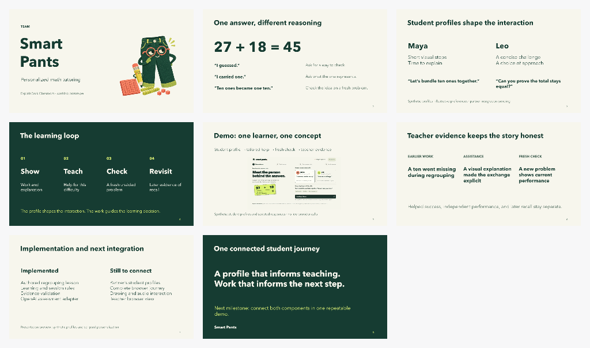

# Smart Pants presentation kit

An eight-slide, five-minute draft with a 90-second demo, speaker notes, and
[judge Q&A](judge-questions.md). **Smart Pants** is the team name;
**ExplainBack Classroom** remains the working product name.

The saved slide deck is in the Codex presentation viewer, Page
`page_f158a30aa214819181688f5c9d6e0d54`. Use the viewer to present or export a
PowerPoint copy. [Authoring callbacks](build-deck.mjs), the
[presenter script](presenter-script.md), and [artwork provenance](assets/README.md)
are stored here so the narrative can be reviewed alongside the code.



## Start the demo

From the repository root, with Node.js 24:

```sh
node presentation/demo-server.mjs
```

Open [the local demo](http://127.0.0.1:3100). It runs separately from `npm start`
and needs no API key, external service, microphone, or new dependency.

For the 90-second walkthrough:

1. Keep **Maya** selected and choose **Start Maya’s lesson**.
2. With **A missing ten** selected, choose **Check this sample**.
3. Choose **Show teaching step**, then **Trade 10 ones for 1 ten**.
4. Choose **Show corrected attempt** to open `36 + 27`.
5. Choose **Check the new problem**, then **See the teacher evidence**.
6. Choose **Try another profile**, select **Leo**, and compare the opening.

**Reset demo** in the header returns to the initial Maya profile at any stage.
Reload also starts a new preview. Stop the local server with `Ctrl+C`.

## Presentation flow

| Time | Topic |
| --- | --- |
| 0:00–0:15 | Smart Pants and the project |
| 0:15–0:50 | One correct answer can conceal different reasoning |
| 0:50–1:25 | Two sample profiles and different interaction preferences |
| 1:25–1:55 | Show, teach, check, and revisit |
| 1:55–3:25 | Browser demo |
| 3:25–3:50 | Teacher evidence |
| 3:50–4:30 | Implemented behavior and remaining integration |
| 4:30–5:00 | The next connected milestone |

Read the [complete script](presenter-script.md) before rehearsal. If the browser
is unavailable, stay on slide 5, explain the screenshot, and continue to slide 6.
No network provider is part of this stage demo, so avoid a paid live API call
during the pitch.

## What the preview demonstrates

The screen demonstrates the intended profile-to-teaching interaction using
synthetic profiles and scripted responses. Its example rubric decisions come
from the existing learning core. It does not run the partner's personality test,
infer a real child's personality, or assess arbitrary freehand work or speech.

Personalization changes the interaction; the mathematical evidence requirements
stay the same. A fresh successful check is current performance, not a learning
gain estimate or evidence of lasting mastery.

## Verification record

Rehearsed on 2026-11-13 in the desktop browser: both profile openings, the
missing-ten teaching route, a fresh check and teacher evidence, the rule/guess
follow-ups, keyboard profile selection, and reset. The saved screenshot is from
that local preview. No provider calls or credentials were used.

The publication checkout passed `npm run check` (15 modules), `npm test`
(127 tests), `npm run test:prototype` (4 tests), and `make check`. The four new
JavaScript modules passed separate syntax checks. All eight slide renders were
reviewed. These checks do not validate the partner's profile component or the
pending full tutor browser integration.

## Rebuild the editable slides

Use the presentation skill and a connected Artifact Session. Import
`build-deck.mjs`, create the cover with `createCover`, and call `appendSlides` in
small batches with `{ slides: [2, 3] }`, then `[4, 5, 6]`, then `[7, 8]`.
Clear only a new document's default empty slide before rebuilding. Supply the
cover PNG to `addCoverImage` and the exercised demo screenshot to
`addDemoScreenshot`. Review every rendered slide before presenting.
