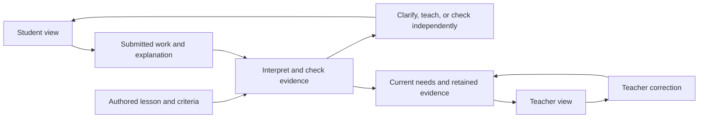
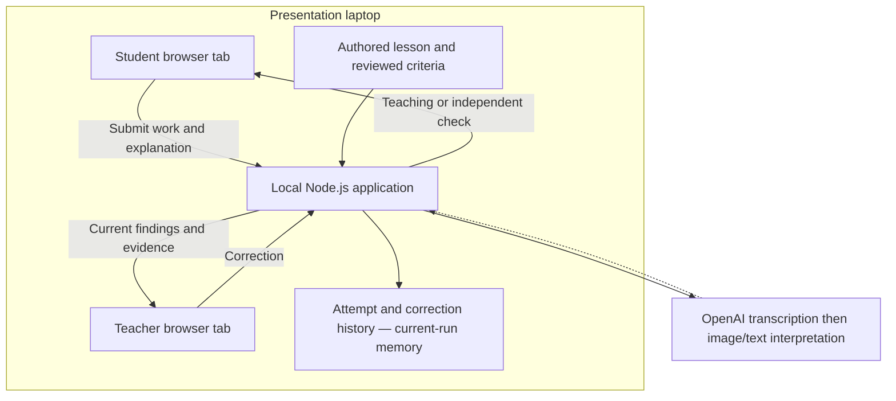

# Technical Plan — journeys and execution choices

Date: 2026-11-11.

Predecessor: [approved Overview & Goals](design_draft.md).
Product rules: [revised concept](concepts_brief.md) and
[resolved review findings](review_resolution.md).

The user approved the opening section and selected **Option A: one laptop**, with
student and teacher browser tabs connected to a local application. This note now
maps the journeys to that execution approach. The author also selected
**current-run memory**: restarting the application clears progress. The author
subsequently selected Node.js with plain browser JavaScript/SVG and freehand
drawing/writing with an explanation. The author selected audio release after
transcription, with transcript evidence retained for the current run and no
teacher audio replay. The teacher view refreshes the current snapshot about once
per second. The author subsequently selected OpenAI transcription-review-image/text
interpretation and original images retained in process memory until reset/restart.
The drafted Technical Plan is now in
[design_draft.md](design_draft.md), and the author has approved that logical plan.

## What the technical plan must enable

The student and teacher views must refer to the same lesson and learner evidence.
The model may interpret an explanation and propose a reviewed next teaching move;
the application must preserve the lesson facts, assistance history, unresolved
interpretations, and the meaning of the teacher count.

### Journey 1: struggle, teaching, and independent improvement

* **Given:** an operator has prepared a lesson and a student/teacher demonstration
  session using synthetic identities and original materials.
* **When:** a learner submits work that supports a difficulty, receives a reviewed
  teaching response, and then applies the idea on a fresh unaided problem.
* **Then:** the teacher first sees the supported need and its evidence, then sees
  the active finding clear after the independent check. The earlier work and
  later-review requirement remain available. A successful hinted answer alone
  cannot trigger that transition.

### Journey 2: work and explanation disagree

* **Given:** the learner's arrangement and spoken explanation support different
  interpretations.
* **When:** the learner submits that evidence.
* **Then:** the tutor asks one neutral follow-up and accepts an explanation or
  visible actions. It does not create a confirmed misconception from the disputed
  evidence. A previously supported finding stays active until improvement is
  demonstrated or its evidence is corrected.

### Journey 3: teacher corrects a finding

* **Given:** a teacher can inspect the evidence associated with a current finding.
* **When:** the teacher retracts an unsupported interpretation.
* **Then:** the displayed finding and relevant count change, while the original
  observation and correction remain in the history. The system distinguishes this
  correction from a child demonstrating improvement.

### Journey 4: a result is delayed, retried, or unavailable

* **Given:** a learner submits work and either changes it, repeats a submission,
  or encounters unavailable model interpretation.
* **When:** a delayed response arrives or the views reconnect.
* **Then:** the learner sees feedback associated with the current submitted work;
  the teacher count does not duplicate the learner. Unavailable interpretation
  remains visible, and authored practice is labeled separately from live model
  assessment. The eventual mechanism depends on the selected execution approach.

## Shared responsibilities, independent of deployment

These are logical responsibilities from the approved goals, not a decision to
create a separate service or module for each row.

| Responsibility | Information in | Required outcome |
| --- | --- | --- |
| Lesson content | Authored problems, expected quantities, rubric, teaching moves, and fresh checks | A stable mathematical objective and a bounded set of appropriate responses |
| Student interaction | Work shown through the chosen controls and an optional explanation | Submitted evidence that the learner can inspect and clarify |
| Interpretation | Submitted visual work and explanation | Evidence-linked observations or a clarification need; no invented lesson facts |
| Teaching and progress | Reviewed observations plus assistance already given | The next teaching move or independent check, with support recorded |
| Teacher feedback | Current supported needs, improvements, corrections, unknowns, and coverage | A useful concept card derived from the same learner records |

The selected prototype hosts its application on the presentation laptop. The
diagram does not choose a network API, database, or event-store implementation.

## Selected execution: one presentation laptop

The student and teacher views open in separate browser tabs against the same local
application. The operator can move between them during the demonstration. The
teacher view uses the same learner evidence as the student interaction rather
than a separately authored set of dashboard numbers.

Local execution is the selected application arrangement. It does not establish
offline AI operation: an external provider would still require permitted project
access and connectivity. No shared-network or hosted application deployment is
needed for this selected demonstration scope. Model placement and access remain
separate decisions.

Both tabs must identify the same demonstration session and the appropriate
synthetic learner. A refresh must not create a second learner or change which work
the teacher is viewing. A delayed interpretation must not replace feedback for
newer submitted work. Teacher updates use the selected periodic snapshot requests;
concrete identifiers, payloads, and student response handling belong in the
Detailed Implementation Plan.

## Architecture decision 1: execution options considered

The author selected A by stating that the prototype can run from the laptop. The
other options remain here as a record of the tradeoffs presented, not as selected
work or as claims that every future deployment alternative has been rejected.
None authorizes real child deployment or changes the existing adult-only applications.

### Option A — selected: one laptop, student and teacher browser tabs

**Mechanism:** run the prototype locally on the presentation laptop. Open one
browser view for the learner and another for the teacher, both connected to that
local application. Present the teacher view when demonstrating its update.

**Tradeoffs:** the operator controls both views on one machine. Device sharing and
application hosting are unnecessary for the stage demo, but this does not establish
that a separate classroom of devices can join. Current-run retention is selected;
the Technical Plan specifies reset, refresh, and restart behavior.

**Fails when:** the first demonstration must use independent student devices or
remain available after the laptop is closed. The model path can also fail if its
required network or project access is unavailable; local application hosting does
not make cloud interpretation offline.

### Option B: a local service shared with devices on room Wi-Fi

**Mechanism:** the laptop serves the prototype to a student device and a teacher
device on the same reachable network. Both views communicate with the same local
application. Provide a browser-trusted HTTPS route for remote microphone capture.

**Tradeoffs:** this demonstrates separate devices without deploying the application
to a hosting provider. It adds network reachability, address/certificate setup,
device permissions, and a local access boundary. Storage and restart behavior
remain decisions for the selected design.

**Fails when:** venue Wi-Fi isolates devices, the host address changes unexpectedly,
or the intended device cannot trust the HTTPS origin. A second device visiting an
HTTP private-network address does not receive the laptop's localhost exception.

### Option C: a private hosted web demonstration

**Mechanism:** deploy the prototype behind an HTTPS URL. Student and teacher
browsers reach the same hosted application using restricted demonstration access
and synthetic sessions. Select shared-state retention and application access
controls as part of that design.

**Tradeoffs:** devices can join through a URL without reaching the presentation
laptop directly. Deployment access, hosting, access controls, record lifecycle,
and ongoing availability add work and operational dependencies. A hosted demo is
still distinct from a service approved for use by children.

**Fails when:** hosting or project access cannot be prepared in time, the venue
cannot reach the service, or deployment/access-control problems prevent a usable
demonstration. Hosting alone does not establish working media or model access.

## Browser facts affecting the choice

Microphone access is restricted to secure contexts and requires permission.
The secure-context rules treat suitable localhost and loopback origins specially;
plain HTTP on a normal private LAN address does not automatically qualify. HTTPS
can meet the origin requirement, but actual permission and capture still need
verification on the intended browser/device.
[W3C Media Capture](https://www.w3.org/TR/mediacapture-streams/#navigator-interface-extensions),
[W3C Secure Contexts](https://www.w3.org/TR/secure-contexts/#is-origin-trustworthy).

The author selected periodic teacher snapshot requests about once per second,
with one active request and visible freshness/failure state. A server-to-teacher
update stream remains an unselected alternative. The browser's `EventSource`
mechanism supports one-way messages from a server over HTTP, but
that fact does not choose it over other update approaches for this prototype.
[WHATWG server-sent events](https://html.spec.whatwg.org/multipage/server-sent-events.html).

These facts constrain browser integration; no application or device path was run
to verify the new prototype.

## Architecture decision 2: history options considered

The author selected A, current-run memory, for structured attempts, help received,
interpretations, teacher corrections, current findings, and later-review status.
Audio release after transcription is now selected, with transcripts retained for
the current run. Original images are retained for that run; the completed plan
records the external-provider handling separately from local release.
The options below preserve the progress-storage tradeoffs presented; SQLite is
not selected work.

### Option A — selected: current-run memory

**Mechanism:** keep the demonstration records in the running local application.
Both tabs use those records while that application remains running. Specify how
a tab reconnects to its session when the concrete interfaces are designed.

**Tradeoffs:** there is no persistent database or database cleanup lifecycle. Earlier
work and later revisiting are available within that running demonstration. A full
application restart or process failure discards the records; a browser refresh
alone is a different event and should not reset an application that is still running.

**Fails when:** the demonstration must recover its progress after an application
restart, or later review must continue in a new application run. The operator must
expect a new session after restarting the application.

### Option B: automatic local SQLite persistence

**Mechanism:** save the structured lesson records in a SQLite database file on the
laptop, then reopen them when the local application starts. Group an accepted
attempt or correction with its corresponding finding update in a transaction, so
the intended record change takes effect together.

**Tradeoffs:** progress can continue across application restarts, but the design
must specify the schema, write failures, restart recovery, and an explicit reset
for synthetic demonstrations. A visible success must correspond to accepted saved
work. SQLite supports transactional changes; the proposed application behavior is
not implemented or verified.
[SQLite transactions](https://www.sqlite.org/transactional.html).

**Fails when:** database writes cannot complete, the database is deleted, or the
laptop's storage is lost. Durability also depends on settings and the failure type;
do not promise protection from every power or operating-system failure without
selecting and checking those settings.
[SQLite synchronization settings](https://www.sqlite.org/pragma.html#pragma_synchronous).

The selected prototype preserves supported practice, independent improvement,
corrections, and later-review status only while the application remains running.
A new application run starts empty. The persistent alternative remains documented
for reference rather than planned implementation.

## Decisions that follow the execution choice

With one-laptop execution and current-run memory selected, the Technical Plan now
specifies restart, refresh, reset, correction, and stale-result behavior. Freehand
input is selected, and recordings are released after transcription. Capture
limits, OpenAI endpoint handling, current-run images, concrete interfaces, and
student response handling are now specified in the completed Detailed
Implementation Plan for approval. Teacher updates use periodic refresh.

OpenAI authentication and six synthetic regrouping audio cases completed in
the [regrouping probe](regrouping_audio_probe.md). That did not test image
interpretation, teaching visuals, or response-time criteria. Before
committing to the full demo path, define a small live case that captures visual
work and speech, shows the interpreted evidence, and selects a reviewed teaching
response or clarification. Its measured result should lead to a proceed, simplify,
or unready decision. Only a project-designated credential may be used for live
API tests.

The current task writes design material only. The author approved the logical
Technical Plan in `design_draft.md`, with the later author choices recorded there.
The author also approved Alternatives Considered. Detailed implementation planning
is complete as a draft in [design_draft.md](design_draft.md#detailed-implementation-plan),
approved by the author on 2026-11-13 and undergoing consolidated review. The [planning note](implementation_plan_notes.md) retains
the alternatives and experiment trail.
